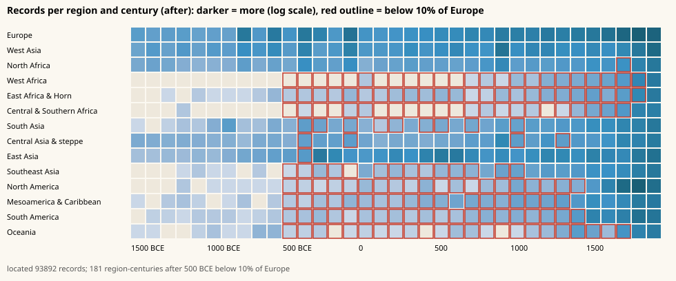

# coverage: the whole world, not just Europe

Owner: thread "Put the whole world in the atlas". Before this folder, 55% of the kernel's located records were in Europe
and South Asia had 48 people. This folder adds people, places and events from everywhere else, from sources, with a
per-region bar instead of one global one, and measures what we know where.




## Files

| File | What |
| --- | --- |
| `people.jsonl` | `person` records born (or active) outside Europe: Pantheon 2025, Wikidata, CBDB. `fame` is Pantheon's HPI; `fame_sitelinks` the Wikipedia language count. |
| `places.jsonl` | CHGIS v6 seats (`place:cn:*`, with their names through time in `alt_names` and `what`), al-Thurayya towns and way stations (`place:thurayya:*`, `attested: [900, 1000]`), Wikidata dated sites and settlements, and birth places the people above need. |
| `events.jsonl` | Wikidata events outside Europe (battles, treaties, revolts, councils, earthquakes, famines, coronations...) from the deep-anywhere thread's dump in `raw/deep/`. |
| `curated.jsonl` | Hand-written `draft` rows with cited works: Swahili coast, Great Zimbabwe and Mapungubwe, Vijayanagara, Srivijaya, Khmer, Cahokia, Tiwanaku, Kanem-Bornu. Adopts the Living Atlas stub for Kilwa until places-people adopted it too (the capitals already have owner records, so their curated rows are skipped). |
| `geo/regions.json` | 14 historical regions on a 0.5-degree grid (run-length rows), from Natural Earth countries: West Asia includes Anatolia and the Caucasus, Central Asia the steppe, Mongolia and Afghanistan; Russia splits at the Urals. |
| `geo/density.json` | "How much we know here" for `ATLAS.world.density`: 5-degree cells x centuries, counts per kind. |
| `report/coverage-<tag>.json, .svg` | Region x century tables (all records and people) and heatmaps, before and after this folder. |
| `report/build-log.txt` | What the last build took from each source. |

New fields: `fame_sitelinks` (people, places, events), `attested` (`[from, to]` years a place is known to have existed,
for gazetteer places with no founding date), `conf` (v0.5 confidence class) on curated rows and on people placed only by
the state they served (`tags: ["placed_by_state"]`, `state`), `part_of` (an event's war or campaign, as text).

## Rebuild

```sh
pip install shapely pyshp                                  # regions.py and the CHGIS reader only
R=/mnt/project-files/atlas/raw
python3 ingest/coverage/regions.py $R/coverage             # needs ne_50m_admin_0_countries.geojson there
python3 ingest/coverage/fetch_people.py $R/coverage        # Wikidata people per country (QLever endpoint), cached
python3 ingest/coverage/fetch_global.py $R/coverage        # people placed by citizenship or office seat
python3 ingest/coverage/fetch_things.py $R/coverage        # dated sites, settlements; thin regions again at 2+ sitelinks
python3 ingest/coverage/extract_cbdb.py $R/coverage        # needs cbdb/cbdb_*.sqlite3 and cbdb_wikidata.json
python3 ingest/coverage/curated.py                         # writes ingest/coverage/curated.jsonl
python3 ingest/coverage/build.py $R                        # writes data/coverage/*.jsonl
python3 tools/build.py && python3 ingest/coverage/coverage.py --tag after
```

`wdq.py` talks to QLever (https://qlever.dev/api/wikidata) by default: the per-country joins for China, India or the
US time out on query.wikidata.org. Set `ATLAS_SPARQL` to switch.

## How the selection works

For each region and century the build first takes everyone who clears a global bar (Pantheon before 1800, 25+
sitelinks), then goes down the list by sitelinks until the region-century reaches its target: people
max(40, half of Europe's people that century), events max(30, a third of Europe's), places max(30, a fifth of
Europe's). The bar is lower where Wikipedia writes less, which is the point: a Kanem mai or a Chola official has
fewer language editions than a minor Victorian MP. Nothing is invented to reach a target; where the sources run out
the gap stays and shows in the heatmap.

## Sources and licences

| Source | Licence |
| --- | --- |
| Pantheon 2025 (Yu et al. 2016, pantheon.world) | CC BY 4.0 |
| Wikidata, via QLever and query.wikidata.org, October 2026 | CC0 |
| China Biographical Database (CBDB), SQLite of 2026-10-24 from huggingface.co/datasets/cbdb/cbdb-sqlite | CC BY-NC-SA 4.0 |
| CHGIS Version 6 time-series prefecture and county points (Harvard Dataverse doi:10.7910/DVN/WW1PD6, Q9VOF5) | CHGIS EULA (non-commercial, attribution) |
| al-Thurayya Gazetteer (althurayya.github.io), after Cornu 1983 | Apache 2.0 (repository licence) |
| Natural Earth 1:50m countries | public domain |

## Gaps left (see the after heatmap)

Sub-Saharan Africa, the Americas and Oceania before about 1400 stay below 10% of Europe in most centuries: named
people and dated events there are few in any written source. The honest fillers are archaeology (dated sites, ancient
DNA samples from the peoples thread, which count here) and oral chronicles; a next pass could add Seshat polity
variables and dated archaeological cultures. Europe's counts at 400 and 100 BCE are inflated by Pleiades' attestation
start years.
